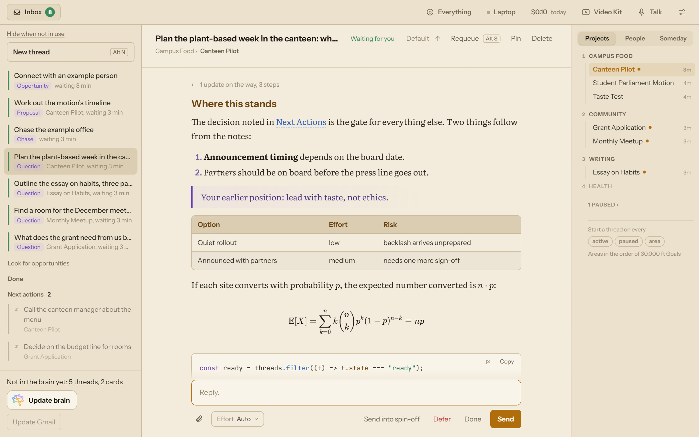
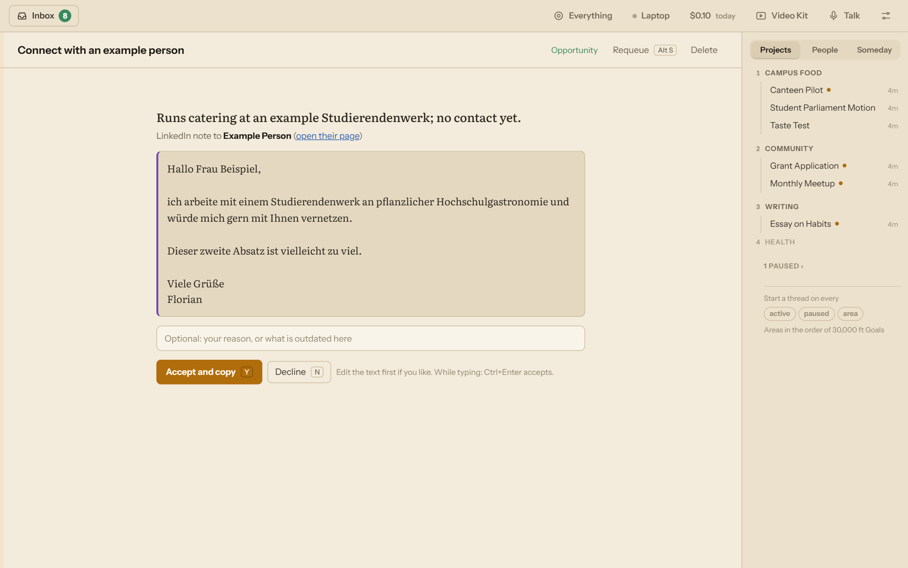
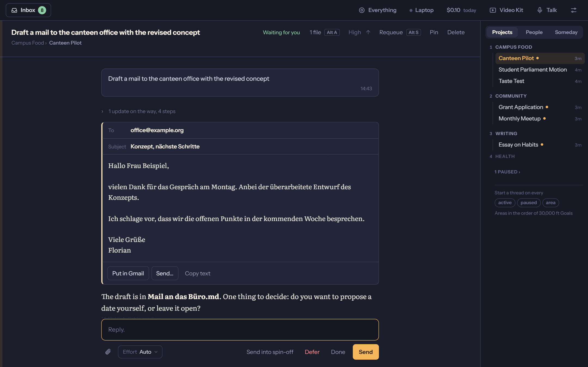
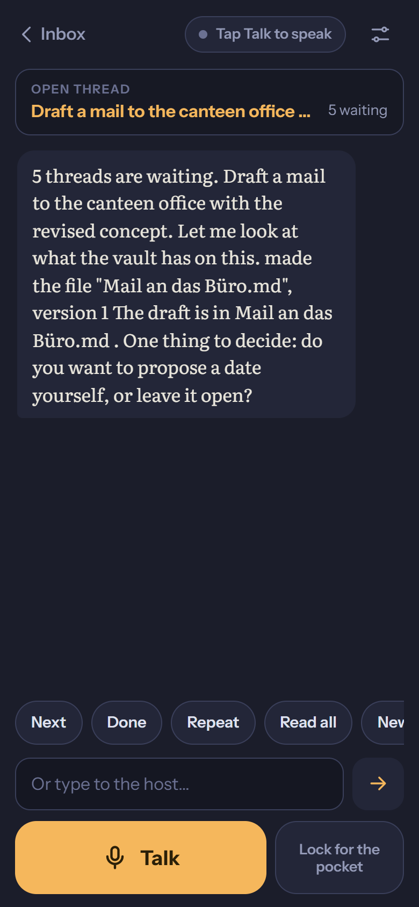
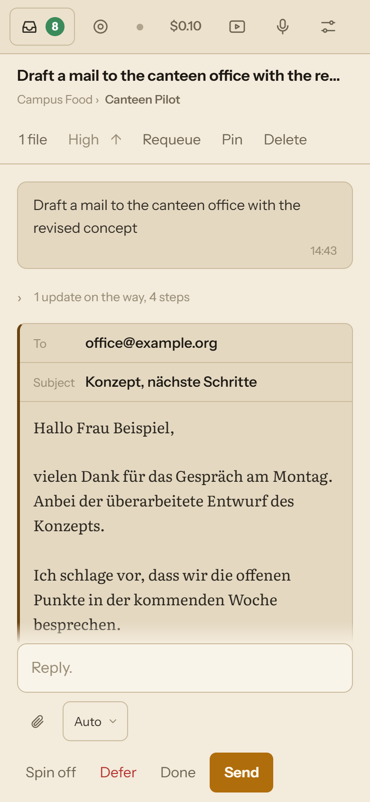
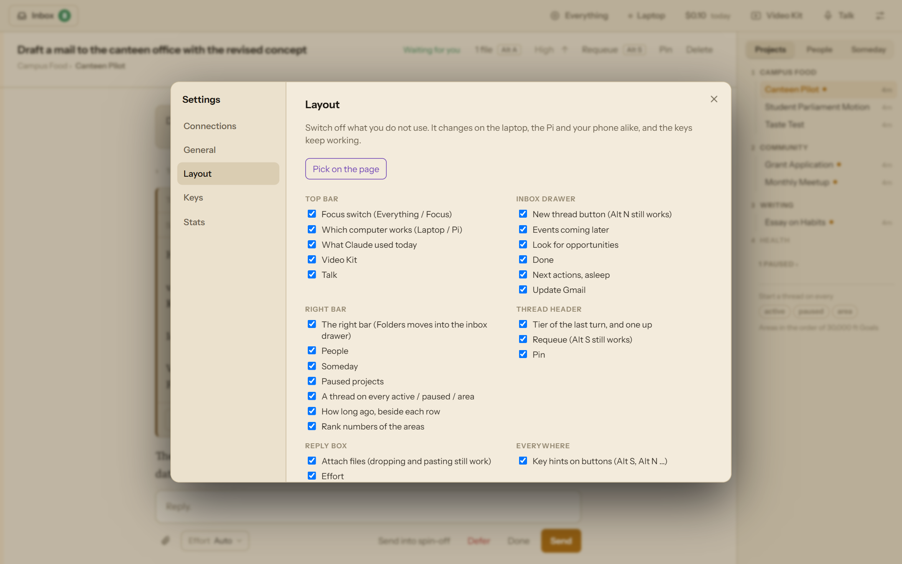
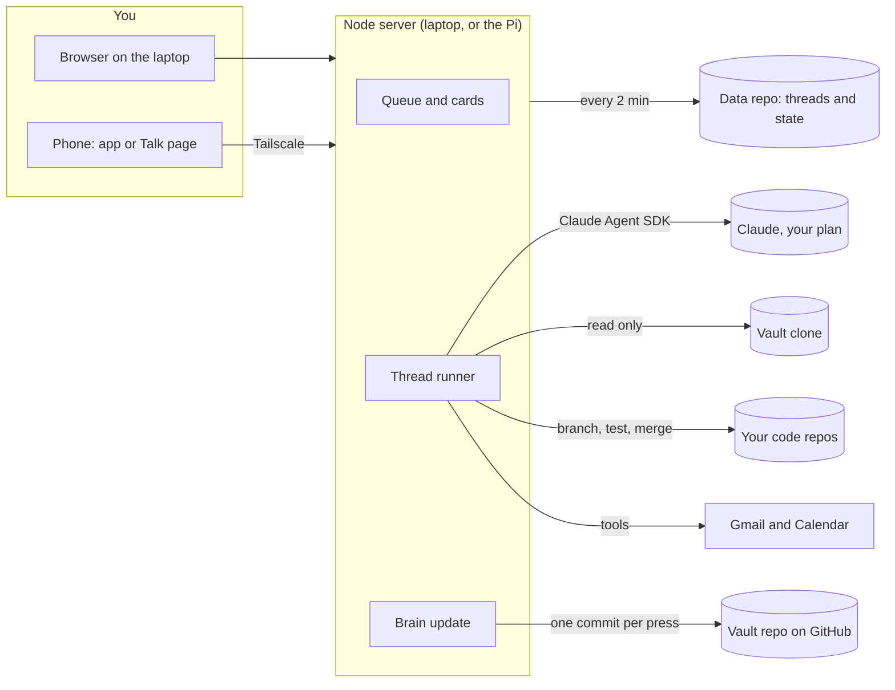

# app-ai: an inbox for working with Claude

**One screen, one thing at a time.** Claude works on many threads in the background. The app shows you only the next thing that needs you: a question, a draft to approve, a mail to send, a contact worth making. You answer, press Enter, and it moves on. Behind it sits a "second brain", a folder of Markdown notes in git, which gives Claude the context and holds what you decide.



<sub>Screenshots are from `npm run demo`: a made-up vault and a stand-in Claude with canned answers.</sub>

It is a personal tool, built for one person's way of working (Getting Things Done, a git vault, a Raspberry Pi in the corner), and most of it was written by Claude in threads of the app itself. It is public so you can look at how it works and borrow from it.

## The ideas behind it

- **You are the bottleneck, not Claude.** So the app manages your attention. A small model ranks what is waiting and learns from what you reply to, put off or close. Claude's turns run in parallel, and a thread only comes back when it needs you.
- **Finished things, not suggestions.** In the background the app makes *cards*: a LinkedIn note, a first mail or a follow-up, written and ready. You accept, edit in place, or decline with a reason, and it learns from the reason.
- **Memory you can read and correct.** Context lives in a Markdown vault on GitHub. Threads can only read it. Facts reach it only when you press **Update brain**: one run files what *you* said and decided, never Claude's own reasoning, and makes one commit. What it is unsure about comes back to you as a thread of questions.
- **Claude never sends.** A mail is a card with **Put in Gmail** and **Send** buttons, and only you press them. Calendar guests are invited only when you ask for it.
- **It runs where you are.** A laptop does the work. A Raspberry Pi takes over when the laptop sleeps, and the phone talks to it, by voice if you like.

## A tour

| | |
|---|---|
|  |  |
| **Cards.** Opportunities, chases for things you are waiting on, and proposals for work Claude could do. Y accepts and copies, N declines. | **Mail.** Claude writes the mail as a card you can edit. Your edits are kept as versions, and the brain update learns your voice from them. |

<p align="center">
  
  &nbsp;&nbsp;&nbsp;
  
</p>

**Talk** (left) is for walking. A small "host" model reads threads aloud and sends what you say to the right place: a reply to the open thread, a new thread, a command, or a question it answers itself. On the right is the whole app in a phone's browser.



**Layout.** Any part of the page can be switched off, either from the list or by clicking it on the page.

There is more, all of it in the [manual](docs/manual.md):

- **Repos.** Any thread can work in a GitHub repo. It gets a branch of its own, and the app runs the tests and merges into main when the turn ends.
- **Events.** Calendar entries worth preparing get a briefing thread the day before.
- **Usage limits.** A turn that hits Claude's limit is held and carries on by itself when the limit lifts.
- **Repairs.** When something breaks, the app opens a thread in which Claude fixes the app's own code.

## How it works



- **Server:** Node 20+, Express 5 and WebSockets in `server/`. Each Claude turn runs through the [Claude Agent SDK](https://docs.claude.com/en/api/agent-sdk/overview), signed in with your Claude subscription rather than an API key.
- **Front end:** plain JavaScript in `public/`, with no build step. It uses marked, DOMPurify, KaTeX and highlight.js.
- **Guard rails in code.** Threads can write only to their own folder, their workbench, and a repo they hold. Push, branch switching and destructive git commands are refused. Sending mail exists only behind a button.
- **Prompts** for each kind of run are in `prompts/`. They point to the rules in the vault instead of repeating them.
- **Tests:** `npm test` runs the whole app against throwaway git repos and a stand-in Claude.

## Try it

You need [Node.js](https://nodejs.org) 20 or newer and Git.

```
git clone https://github.com/fburgerdev/app-ai
cd app-ai
npm install
npm run demo
```

`npm run demo` needs no account. It builds a throwaway vault, starts the app with a stand-in Claude and opens it in the browser.

## Setting it up for real: what you need for what

Only the first row is required. Everything else adds one feature and can be left out.

| You want | You need | Guide |
|---|---|---|
| **The app itself** (threads, queue, brain update) | Node 20+ and Git; a Claude subscription, signed in once with `npm run login`; a vault repo on GitHub you can push to, set as `brainRepo` in `config.json` | below |
| Threads and state kept on GitHub, and taken over by another computer | A second, private repo as `dataRepo` (leave it empty to keep everything local) | [manual: state](docs/manual.md#where-things-are-and-how-the-state-is-saved) |
| The app starting with Windows and updating itself | Double-click `deploy\windows\install-autostart.cmd` once | [laptop.md](docs/laptop.md) |
| Gmail and Calendar (mail cards that send, events, mail threads) | Your own Google Cloud OAuth client, about 10 minutes, free | [google.md](docs/google.md) |
| The app on your phone, and the Talk page with speech | Tailscale on both devices, plus `tailscale serve` and `allowedHosts` (speech needs https) | [pi.md](docs/pi.md#without-a-pi-reaching-the-laptop-from-the-phone) |
| Work going on while the laptop sleeps | A Raspberry Pi 4/5 (64-bit) with Tailscale, the systemd units in `deploy/`, and `remote` in the laptop's config | [pi.md](docs/pi.md), [laptop.md](docs/laptop.md) |
| Better listening and a real voice on Talk | A Groq key (Whisper); Piper on the server; an OpenAI key as an option | [voice.md](docs/voice.md) |
| Calling the inbox from a real phone number | Twilio with ConversationRelay and a public https address. Built and tested against a simulated call only. | [calling.md](docs/calling.md) |
| Claude renaming and creating repos | Nothing if git on the machine is signed in; otherwise a GitHub token | [repos.md](docs/repos.md) |
| Claude running commands on the Pi (`pi_shell`) | An SSH key from the laptop to the Pi, and a sudoers entry | [pi.md](docs/pi.md#claude-runs-the-pi) |
| Video Kit (a player for video scripts) | The `app-ytvideo-kit` repo. It is specific to this setup: switch it off with `"videoKit": { "enabled": false }` | [manual](docs/manual.md#video-kit) |

### With your own vault

The defaults point to the author's private repos, so set your own before the first real start. Run `npm start` once to create `config.json` in the data folder (`%LOCALAPPDATA%\app-ai` on Windows, `~/.local/share/app-ai` on Linux). Then set:

```json
"brainRepo": "https://github.com/you/your-vault.git",
"dataRepo": ""
```

The app expects a vault laid out like this. A missing file only switches off the part that reads it:

```
CLAUDE.md                      how Claude should work with you
Claude/Instructions.md         the rules, put into every thread
Claude/Thinking With Me.md     how thinking sessions run, put into every thread
Core/Projects/Projects Index.md   projects listed under "## [[Area]]" headings
Core/Projects/*.md, Core/Areas/*.md   one note each, with a "Status:" line for projects
Core/People/*.md               "Last contacted:" and "Status:" lines
Core/Next Actions.md           "- [ ] …" lines under "## [[Project]]"
Core/Waiting For.md, Core/Someday.md, Core/Horizons/30,000 ft Goals.md
```

`npm start` then opens http://localhost:4317. To give it its own window, use **Install** in Chrome or Edge.

Be warned that the prompts in `prompts/` are written for one person and use his name. Adapting them is the real work if you want to use this yourself.

## Docs

- [docs/manual.md](docs/manual.md): every feature, every key, and every setting in `config.json`
- [docs/laptop.md](docs/laptop.md): autostart, and handing over between the laptop and the Pi
- [docs/pi.md](docs/pi.md): running it on a Raspberry Pi, and reaching it from the phone
- [docs/google.md](docs/google.md): connecting Gmail and Google Calendar
- [docs/repos.md](docs/repos.md): threads that work in GitHub repos
- [docs/voice.md](docs/voice.md): Whisper and Piper for the Talk page
- [docs/calling.md](docs/calling.md): calling in through Twilio

## Layout of the repo

```
server/     the app: runner, queue, cards, brain update, mail, repos, sync, voice
public/     the page (index.html, app.js) and the Talk page (walk.html, walk.js)
prompts/    the instructions for each kind of Claude run
deploy/     systemd units and the update script for the Pi, autostart for Windows
scripts/    login, demo, read-log viewer
test/       node --test suites, run against a stand-in Claude
docs/       the guides above
```
